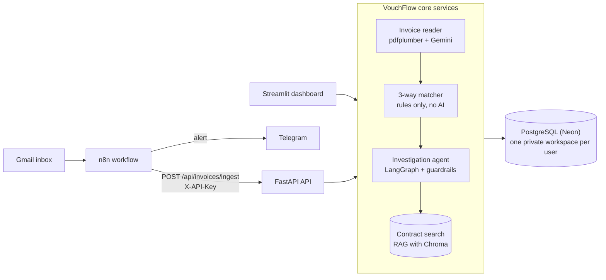
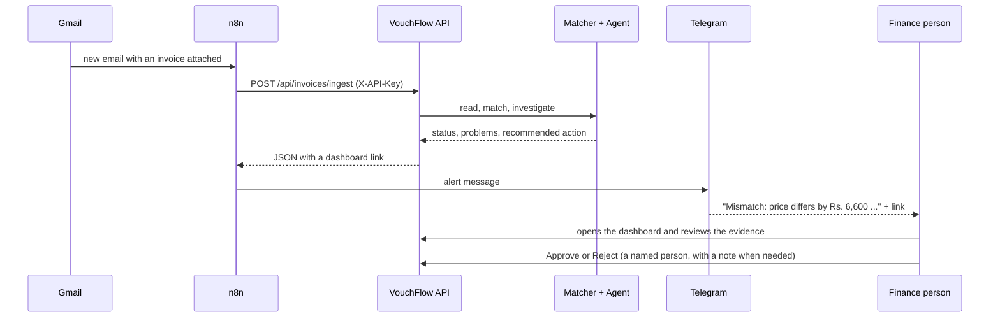

# VouchFlow AI

**An AI assistant for accounts-payable teams.** It reads supplier invoices, checks each one against the
**purchase order**, the **goods received note** and the **supplier contract** ("3-way matching"), explains what is
wrong with evidence and quotes, and tells a person what to do next. **A human always approves.** Nothing is ever
approved or paid automatically.

> **Everything in the demo is fake data.** The invoices, suppliers and contracts are generated test data.
> VouchFlow has not been tested on many real invoices yet (see [Limitations](#limitations)).

---

## What it does

1. **Reads** an invoice (PDF or image) and pulls out supplier, invoice number, dates, line items and totals (Gemini).
2. **Checks** it with plain, deterministic rules (no AI in the decision): prices vs PO and contract, quantities vs
   PO and goods received, the maths (line total, 18 % GST, grand total), missing PO, duplicates.
3. **Investigates** each finding with an agent that looks up the matching contract clause and writes a clear,
   evidence-backed explanation and a *recommended* next step.
4. **Alerts** you (optional, with n8n): a Telegram message with the supplier, amount, problem and a link.
5. **Waits for a person** to approve or reject in the dashboard. Every decision is written to an audit log.

## Architecture



## The full flow: email to approval



## What is inside

| Part | What it does |
|---|---|
| **Invoice reader** | pdfplumber text + Gemini (with automatic model switching); fails safely: unreadable invoices go to "needs review" |
| **3-way matcher** | Rule engine in pure Python: price, quantity, totals/GST, missing PO, duplicates, low-confidence extraction |
| **Contract search (RAG)** | Clause-level semantic search over supplier contracts (ChromaDB + local ONNX embeddings); says "no source found" instead of guessing; one private index per workspace |
| **Investigation agent** | LangGraph workflow: load, match, fetch PO/GRN facts, search contract, build evidence, explain. Advisory only |
| **Guardrails** | *Grounding* (numbers in the explanation must exist in the evidence), *permissions* (the agent can never approve or pay), *injection check* (instructions hidden inside an invoice are ignored) |
| **Approvals** | Only a named person can decide; software names (agent, bot, n8n, ...) are refused; a note is required to reject or to override the agent; one decision per report; audit-logged |
| **Workspaces and login** | Email + password (bcrypt). Every user has a private workspace; every query is filtered by workspace |
| **Your own data** | Upload invoices (PDF/PNG/JPG), purchase orders, goods received notes and contract prices (CSV with templates), contract documents (TXT/PDF) |
| **Ingest API + n8n** | API keys per workspace (stored as hashes), rate limit, ready-made n8n workflows (Gmail to Telegram, and a webhook for testing) |
| **Fair AI limits** | Template explanations by default; real Gemini explanations limited to 5 per user per day |

## Run it on your computer

```bash
pip install -r requirements.txt
python -m alembic upgrade head              # create the tables (SQLite by default)
python scripts/seed_db.py --demo-runs       # fill the shared "sample" workspace with fake data
streamlit run dashboard/app.py              # dashboard at http://localhost:8501
python -m uvicorn backend.main:app --reload # API at http://localhost:8000  (docs at /docs)
```

Create an account on the dashboard (tick *Start with sample data*) and explore. Configuration lives in a `.env` file
(copy `.env.example`; every setting is explained there). Without a Gemini key everything works except reading new
invoices by AI: they land in "needs review" and explanations use the plain template.

**With Docker:** `docker compose up -d --build` starts the API, the dashboard and n8n (see [DEPLOY.md](DEPLOY.md)).

## How to use it

1. **Home**: invoice ledger with status pills (verified / needs review / mismatch) and a drill-down into line items.
2. **Investigation**: pick an invoice, *Run investigation*, read the evidence tables (what was compared, value, source),
   the contract quotes and the guardrail results. Optionally tick *Use AI explanation* (5 per day).
3. **Approvals**: the queue of investigated invoices; a named person approves or rejects.
4. **My data**: upload your own invoices, POs, GRNs, contract prices and contracts.
5. **Settings**: create an API key for automation (shown once).
6. **Evals**: the saved evaluation results.

Try the two ready-made fake invoices in `data/samples/` (see [n8n/README.md](n8n/README.md)): one is clean, one bills a
desk at Rs. 12,600 instead of the contract price of Rs. 12,000.

## Results

Real numbers from the evaluation scripts in `scripts/` (result files in `data/evaluation/`). The answer keys are
generated by this project (see Limitations). The matcher, contract-search and agent evaluations were **re-run on
5 Nov 2026, after login and workspaces were added, with the Gemini key switched off: the results are identical**. Run them
yourself with `python scripts/run_matching_eval.py --all` (also `--hard`), `python scripts/eval_hard_v2.py`,
`python scripts/run_contract_rag_eval.py` and `python scripts/run_agent_eval.py`.

| Part | Test set | Result |
|---|---|---|
| **Invoice reader** (Gemini) | 48 sample invoices attempted | 47 read. Of those, **44 were really read by Gemini and all 44 matched** the answer key (vendor, number, date, total, item count). 3 rows were mock values and **1 invoice was not read** (daily quota). The headline "47 / 48" mixes these, so the honest number is 44 / 44 real reads |
| **3-way matcher**: sample set | 50 invoices (35 clean, 15 with planted mistakes) | **50 / 50** correct status and mistake type |
| **3-way matcher**: hard set 1 | 40 invoices (rounding-size price gaps, compound mistakes, ...) | **40 / 40** |
| **3-way matcher**: hard set 2 | 30 invoices | **30 / 30** |
| **Contract search** | 15 questions (10 answerable, 3 with no source, 2 conflicting contracts) | **15 / 15** correct answer type and source |
| **Investigation agent** | 20 invoices | **20 / 20** correct action, tools, citations and safety; 150 numeric claims checked, **0 ungrounded**. All 20 used the *template* explanation, not Gemini |
| **Test suite** | pytest, Gemini always mocked, own database | **285 tests pass in about 2 minutes** (`python -m pytest -q`) |

## Limitations

- **Generated data.** Invoices, POs, GRNs and contracts are fake and follow a clean, regular layout. Real invoices are
  messier (scans, odd layouts, other currencies and tax rules).
- **The same author wrote the code and the tests.** The planted mistakes and the matcher were made by the same
  project, so 100 % on those sets shows the rules do what the author intended, not that they catch everything real
  suppliers do. Independent review and real data are still needed.
- **Evaluation caveats.** The reader score covers 44 real Gemini reads (3 mock rows and 1 unread invoice are in the
  saved file). The agent was evaluated with template explanations only; Gemini-written explanations rely on the
  grounding guardrail but were not benchmarked.
- **Free-tier AI limits.** Gemini free quotas are small and models change. Reading is rate-limited per API key and
  explanations are limited to 5 per user per day. Without a key, invoices cannot be read automatically.
- **Not tested on many real invoices yet.** Treat results as a prototype, not as audit-ready control.
- **Scope.** One currency (Rs.) and Indian 18 % GST are assumed in the checks. Scanned (image-only) PDFs cannot be
  used as contract documents. Rate-limit counters live in one server process.
- **Not formally security-audited.** See Security for what is implemented.

## Security

- **Workspace isolation.** Every table that holds business data carries a workspace id and every query is filtered
  by it. Another workspace's invoice answers "not found". Tests prove that user A cannot read, check, investigate or
  approve user B's data through the dashboard code or the API.
- **Passwords are hashed** with bcrypt; plain passwords are never stored. Login and unknown-email answers are identical.
- **API keys are hashed** (SHA-256); the key is shown once and can be revoked. A key reaches one workspace only. A login
  token does not work on the automation API and an API key does not work on the dashboard API.
- **No auto-approval, no auto-payment.** The agent's permission table blocks approve/pay; the approval rules require a
  named human; automation only reports.
- **Audit log** of uploads, extractions, checks, investigations, key creation/revocation and every decision.
- **Secrets stay out of git.** `.env`, `.streamlit/secrets.toml` and user uploads are ignored; example files hold no
  secrets; placeholder text counts as "not set"; in production the app refuses to start without a real database link
  and signing key and names the missing variable. Tests never use the real Gemini key or the real database.
- **Uploads are validated** (type, size, real file signature) and stored per workspace.

## Tech stack

FastAPI, Streamlit, PostgreSQL (Neon) with SQLAlchemy 2 and Alembic migrations, LangGraph (agent), RAG with LangChain +
ChromaDB and local ONNX embeddings, Gemini through `google-genai`, pdfplumber, bcrypt, guardrails (grounding,
permissions, injection), automated evals, n8n (automation), Docker, pytest.

## Project layout

```
backend/      API, database, services, matcher, agent, guardrails, auth
dashboard/    Streamlit app (router, pages in views/, theme in ui_common.py)
migrations/   Alembic migrations
n8n/          workflow files and beginner guide
scripts/      data generation, seeding, evaluation scripts
tests/        pytest suite (offline; Gemini is mocked)
data/         sample invoices, contracts, samples/, evaluation results
docs/         architecture notes, screenshot checklist and demo script
```

## Deploying

See **[DEPLOY.md](DEPLOY.md)**: Neon, Render (API), Streamlit Community Cloud (dashboard), n8n, Docker, and a checklist.

## Next steps

- A paid Gemini key (higher limits, no free-tier rotation) and a benchmark of Gemini-written explanations.
- Encryption per company (workspace-level keys) and an optional single-tenant deployment.
- Audit exports (CSV/PDF of decisions with their evidence).
- Gmail OAuth hardening (verified app, least-privilege scopes, secret rotation) and more automation channels.
- Evaluation on real, anonymised invoices with an independent reviewer; support for other currencies and tax regimes.
- Per-workspace daily caps on AI reading; a shared rate limiter for multi-server deployments.
